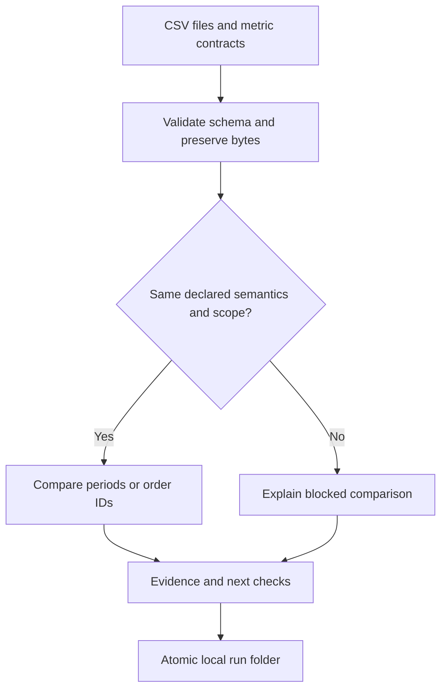

# Analytics reconciliation preview

**Question:** Are the two exports measuring the same thing, and what remains different after explicit scope and duplicate rules?

This local tool is for an analyst, marketing operations owner or founder investigating conflicting reports. It accepts canonical CSV files with JSON metric contracts. It produces evidence and next checks that an operator can review. It does not connect to an analytics account or identify the cause of a tracking failure automatically.

## Try the synthetic purchase case

From the repository root, use Python 3.11 or newer with an IANA timezone database available to `zoneinfo`. Linux and macOS normally supply that database. The engine uses only Python's standard library; no account, model, API key or package installation is required.

```bash
python -m unittest discover -s tests -v
python -m reconciliation --config examples/reconciliation/purchases/config.json --output .private/reconciliation
```

The command prints the full path to `report.html`. Open that file in a browser. The report works offline, with no external scripts, styles or network resources. A committed [synthetic sample report](sample/README.md) is also available for review.

| What the fixture contains | Expected result |
| --- | --- |
| Reference completed production orders | 100 |
| Observed purchase rows before scope and duplicate checks | 103 |
| Identical extra purchase rows, under a unique order-ID contract | 5 |
| Rows in the test environment | 2 excluded |
| Matching valid order IDs | 96 |
| Reference order IDs absent from the observed export | 4: `order-097` through `order-100` |
| Unique eligible order amounts | Reference USD 10,000; observed USD 9,600 |

The naive difference, 103 minus 100, hides the four missing orders. This is a synthetic correctness example. It is not a customer case, a revenue result or evidence that a particular analytics platform is broken.

## The two implemented workflows

| Workflow | Inputs | Useful answer | Boundary |
| --- | --- | --- | --- |
| `aggregate` | Daily or whole-period canonical metric exports | Which compatible periods differ; whether the complete period total differs | Aggregate counts cannot identify missing orders or individual users |
| `purchases` | Reference and observed order-level exports | Duplicate rows, conflicting IDs, excluded rows, missing or unexpected IDs, amount differences | Requires stable order IDs and completed/production scope; no identity inference |

```bash
python -m reconciliation --config examples/reconciliation/aggregate/config.json --output .private/reconciliation
python -m reconciliation --config examples/reconciliation/definitions/config.json --output .private/reconciliation
```

The aggregate example compares `100, 120, 0` against `100, 117, 0`. Two days pass and one fails the threshold. The complete totals, 220 and 217, also fail. The definitions example compares pageviews with active users and blocks numerical reconciliation.

## What happens to an import



Imports are standalone snapshots. Files from separate runs are never appended into one dataset. Reusing the same bundle and engine source produces the same run ID and verifies the existing files. Changed input bytes, configuration or engine source produce a new run. There is no cross-run incremental merge, overlapping-file consolidation, shared cache or database service in this preview.

The contract gate compares project, metric ID, definition, aggregation, unit, currency, timezone, grain, inclusive start, exclusive end, filters, attribution, tracking, bot policy and consent policy. A shared metric label alone is insufficient. All of these fields must match for an equivalent comparison. This deliberately conservative first version has no configurable semantic crosswalk. Providers with different native definitions will often be blocked.

**Contracts are operator assertions.** The tool cannot verify that an export actually used the stated settings. Keep original provider exports and query settings separately, and document any conversion into the canonical format. Native formats from GA4, Umami, Plausible or PostHog require a reviewed adapter or manual mapping before import.

## Prepare an input bundle

Copy an entire example folder into a local working folder. Keep `config.json`, both contract files and both CSVs in that folder or its descendants. Input paths are relative to the configuration file. Absolute paths and links that escape the bundle are rejected. Put actual exports under `.private/`, which is ignored by Git.

Every JSON field is required; unknown fields and duplicate JSON keys fail validation. The [example configuration](../../examples/reconciliation/purchases/config.json) and [example contract](../../examples/reconciliation/purchases/reference.contract.json) provide the exact machine-readable shape.

Versioned structural JSON schemas are supplied for [configuration](../../schemas/reconciliation/v1/config.schema.json), [metric contracts](../../schemas/reconciliation/v1/contract.schema.json) and [serialized findings](../../schemas/reconciliation/v1/finding.schema.json). The Python runner also checks cross-field semantics, actual dates, timezone availability, file containment and CSV content. Schema validation alone does not establish a valid comparison.

| Configuration field | Meaning |
| --- | --- |
| `version` | Integer `1` |
| `workspace` | 1 to 64 letters, numbers, underscores or hyphens; first character alphanumeric |
| `workflow` | `aggregate` or `purchases` |
| `comparison.class` | `equivalent_under_conditions`, `related_not_interchangeable` or `unsupported` |
| `comparison.rationale` | Required explanation of why the sources can or cannot be compared |
| `tolerance.absolute` | Nonnegative decimal string in the native metric unit; for ratios use the fraction, not percentage points as whole numbers |
| `tolerance.relative` | Nonnegative decimal string; `0.01` means 1% of the reference value |
| `reference`, `observed` | Each has exactly `contract` and `csv`, containing relative file paths |

A difference passes when its absolute size is at most `max(absolute tolerance, abs(reference) × relative tolerance)`. The threshold applies to each period or matched order amount, and to complete aggregate period totals. A zero reference has no percentage difference unless both values are zero. Negative deltas are retained. Amounts use decimal arithmetic with 80 digits of working precision; supplied numbers are limited to 32 characters. JSON emits decimal values as strings.

| Contract fields | Meaning |
| --- | --- |
| `version`, `source`, `project_id` | Schema version 1, native source label, canonical project identifier |
| `metric_id`, `definition` | Explicit canonical metric name and business definition |
| `aggregation` | `sum`, `distinct`, `ratio` or `records` |
| `unit`, `currency` | `count`, `money` or `ratio`; money needs an uppercase three-letter code, other units need JSON `null` |
| `timezone`, `grain` | IANA timezone; `day`, `period` or `record` |
| `start`, `end_exclusive` | `YYYY-MM-DD`; the end date is excluded |
| `filters` | Text key/value pairs; purchases require exactly `status: completed` and `environment: production` |
| `attribution`, `tracking`, `bot_policy`, `consent_policy` | Explicit policy descriptions; use an explained `not applicable` where appropriate |
| `exported_at` | Timestamp with an explicit UTC offset |
| `mature_after_hours` | Integer from 0 through 8760; elapsed hours after local period end |
| `complete` | Boolean assertion that the source export is complete |
| `native_warnings` | Array of source warnings, including sampling, truncation or processing restrictions |

Currency codes are syntactically checked, not checked against a maintained ISO registry. Mixed eligible currencies are rejected; there is no exchange-rate conversion. A missing timezone database causes an actionable input error. This preview supports one metric and one currency per side of a run, with no extra dimensions or campaign joins.

### Aggregate CSV

Exactly these headers are required, in any order:

```csv
period_start,period_end_exclusive,value,numerator,denominator
2026-09-01,2026-09-02,100,,
```

Each daily row must cover one calendar day in the declared timezone. A period-grain export must contain a single row spanning the whole contract period. Duplicate or overlapping periods are rejected. Daily aggregates cannot be converted to another timezone after import. Missing days and blank values are reported, including days missing from both exports. They are never silently replaced with zero.

For `ratio`, leave `value` blank and supply nonnegative integer `numerator` and `denominator`. Period ratios are computed by adding components and then dividing. A zero denominator makes that row's ratio undefined; other rows can still supply a valid whole-period ratio. Period distinct users can be compared directly, but daily distinct counts are never summed into a whole-period user count. Partial totals are labelled and receive no complete-period variance calculation.

### Purchase CSV

Exactly these headers are required, in any order:

```csv
order_id,occurred_at,status,environment,amount,currency
order-001,2026-09-01T12:00:00Z,completed,production,100.00,USD
```

Timestamps need UTC offsets. Scope is evaluated using the contract timezone and exclusive end date, including daylight-saving transitions. Nonmatching status, environment or date rows are excluded with evidence. IDs are opaque, case-sensitive text and must not be blank. An aggregate-only export cannot use this workflow.

Eligible rows with the same ID, instant, amount and currency are duplicates under the declared unique-order contract. They contribute once and produce a duplicate-row finding. Conflicting eligible records for an ID are quarantined. The same ID is then removed from matching on both sides, preventing a false missing-order finding. Valid native totals are labelled partial when any IDs are quarantined. No fuzzy joining, tax adjustment or refund inference occurs.

## Read a finding correctly

| Classification | What it establishes |
| --- | --- |
| `confirmed_processing_defect` | Duplicate eligible rows exist in this export under its declared unique-ID contract; the originating website or connector defect remains unproven |
| `expected_definition_difference` | Related metrics are intentionally kept separate, or rows were excluded by explicit scope |
| `provisional_source_changing` | The export is incomplete, warned, or captured before its declared maturity window; gaps may change |
| `unexplained_variance` | A compatible value, amount or record differs; the exports do not establish why |
| `not_comparable` | Unsupported comparison or conflicting declared semantics |
| `within_tolerance` | Numeric agreement within the stated threshold for the specified scope; not proof of collection accuracy |

`SOURCE_PROVISIONAL` can coexist with within-tolerance findings. Agreement on an immature export is still provisional. Maturity is assessed at export time, so waiting without obtaining a new export does not turn an old snapshot into a final one. Every native warning conservatively makes the source provisional.

## Saved output and operation

```text
<output>/<workspace>/<run_id>/
  manifest.json
  report.html
  report.json
  findings.csv
  inputs/config.json
  inputs/reference.contract.json
  inputs/observed.contract.json
  inputs/reference.csv
  inputs/observed.csv
```

Each manifest is a completed run ledger entry with creation time, input hashes, engine source hashes and output checksums. The run ID uses input bytes, engine version and a fingerprint of the Python module files. Output is built in a temporary sibling directory and published by directory rename. Handled failures clean up staging files. Abrupt process termination can leave `.pending-*` directories; those are not completed runs and may be removed after confirming no run is active.

Repeat runs verify the saved file set and hashes. If verification fails, inspect the changed files and use a fresh output root. Checksums detect accidental changes; they are not digital signatures or protection against someone rewriting the manifest. Use a local filesystem supporting atomic directory rename; distributed storage and power-loss durability are not verified. Workspace separation prevents accidental path mixing, but is not multi-user access control. Raw snapshots can contain sensitive order IDs and remain in the run folder. Only synthetic examples belong in Git.

HTML escapes imported text and uses no scripts. Findings CSV neutralizes leading spreadsheet formula characters. The command exits `0` when a report is produced, including blocked comparisons and discrepancies; it exits `2` for input or filesystem errors. Read `summary` and `classifications` to implement a policy gate rather than interpreting exit `0` as numerical agreement.

## Evidence, performance and remaining work

The [verification record](verification.json) records the tests and sample checks. [The synthetic benchmark](benchmark.json) records this environment's timings and peak process memory. Reproduce it on a POSIX system:

```bash
python scripts/benchmark_reconciliation.py --rows 100000 --result .private/benchmark.json
```

The benchmark has four 100,000-row CSVs across two aggregate comparisons, one count and one money metric. It checks the expected exception count and includes ingestion, analysis, rendering and checksum verification. Input generation is excluded from elapsed time. It is not a benchmark of provider accuracy, exception-heavy reports, purchase matching, onboarding effort, an 8 GB laptop, manual time savings or superiority over existing tools.

This version uses standard-library CSV parsing and decimal arithmetic to make the local workflow runnable without installing a database. DuckDB remains a possible adapter for larger, multidimensional or Parquet workloads; it is not a dependency or an implemented integration here.

Remaining work includes native export adapters; authorized read-only source APIs; pagination, retry and permission handling; independently captured query settings; semantic crosswalks; large exception sets; real-workflow usability trials; and comparison against a manual baseline. There is no MCP server, browser upload interface, automated remediation or public deployment. The original CRM pipeline calculations remain a separate module.

Developers and coding agents should start with the [agent guide](AGENT_GUIDE.md).
